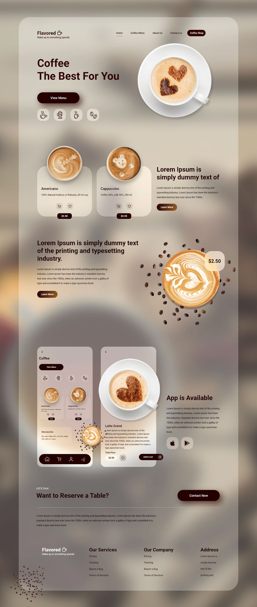
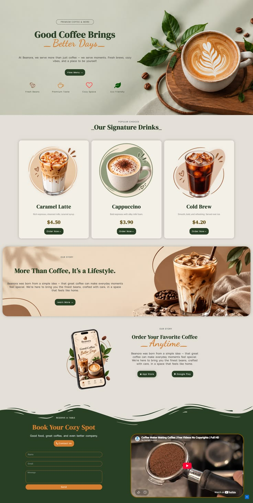

# 咖啡廳網站視覺與版面設計

## 設計方向

以第二張參考圖的奶油米白、森林綠與焦糖橘作為主要品牌方向，呈現自然、舒服且有手作感的獨立咖啡廳。第一張參考圖則用於借鏡產品卡片、咖啡品項展示與手機版內容的編排方式。

兩張圖是版面與風格參考，不建議將整張長圖直接當作網站背景或頁面圖片：圖片內的假文案、價格、品牌名稱和介面不可讀取或操作。實際網站應以 HTML 文字、按鈕與獨立咖啡照片重建各區塊。

## 參考圖

### 參考圖 A：咖啡產品與卡片編排

- 借鏡大幅主視覺、飲品去背圖與產品卡片交錯排列的節奏。
- 可參考中段的產品介紹與「飲品圖片＋簡短說明＋價格」結構。
- 保留圓角卡片與柔和陰影，但避免過多模糊背景，以維持文字對比和載入效率。
- 圖中的 App 下載區只有在品牌確實有 App 時才採用；否則改成外帶預訂或門市資訊。

### 參考圖 B：品牌色彩與頁面節奏

- 作為主要視覺方向：奶油色底、森林綠標題與區塊、焦糖橘 CTA。
- 借鏡首屏左右分欄的咖啡主圖、人氣飲品卡片、品牌故事橫幅與預約區塊。
- 圖中的顧客評價、App、影片或其他功能，只有在有真實內容與服務支援時才上線。

## 色彩與字型

| 用途 | 色彩 | 色碼 |
|---|---|---|
| 頁面底色 | 奶油米白 | `#F5F0E8` |
| 品牌主色 | 森林綠 | `#294832` |
| 標題／深色區塊 | 深焙咖啡 | `#3B2A22` |
| 主要 CTA | 焦糖橘 | `#C46A3B` |
| 卡片底色 | 暖白 | `#FFFCF6` |
| 主要內文 | 深炭灰 | `#292725` |

- 標題與品牌故事使用思源明體，增加溫度與質感。
- 導覽、內文、表單與按鈕使用思源黑體，維持易讀性。
- 英文品名與數字使用 Titillium Web。
- 主要 CTA 使用焦糖橘底與高對比文字；避免以顏色作為唯一狀態提示。

## 首頁桌機版區塊配置

1. **導覽列**：左側品牌 Logo，右側「首頁、咖啡與餐點、品牌故事、門市資訊」，末端放置「外帶預訂」與「立即訂位」。
2. **主視覺**：左側放置品牌標語「讓今天，從一杯好咖啡慢下來」、一行價值主張和「查看菜單」CTA；右側使用單杯招牌咖啡的高品質照片。背景採奶油米白，避免將整張參考圖作為底圖。
3. **品牌特色**：以 3–4 個簡潔圖示呈現選豆、手作沖煮、舒適空間等特色，圖示旁附文字標籤。
4. **人氣飲品**：一列 3 張飲品卡片，呈現照片、品名、短描述、價格與「加入外帶」或「查看品項」。卡片版型參考圖 A，配色沿用圖 B。
5. **品牌故事**：圖文橫幅，左側介紹品牌與咖啡理念，右側使用店內或咖啡製作的實拍照，連結至完整故事。
6. **門市與訂位**：森林綠底色區塊，放置地址、營業時間、交通資訊與簡短訂位入口；表單只要求完成訂位必要的欄位。
7. **頁尾**：門市聯絡方式、營業時間、社群連結、菜單與訂位入口。

## 手機版與互動

- 導覽縮為 Logo、選單按鈕及固定可見的「訂位」入口。
- 主視覺改為單欄：標題與 CTA 在前，咖啡照片在後；首屏不堆疊多個促銷元素。
- 飲品卡片採單欄或可橫向滑動的卡片列，避免縮小卡片文字。
- 訂位表單欄位全寬排列，按鈕高度至少 44px，並提供清楚的錯誤提示。
- 圖片使用適合版面的裁切比例與替代文字；裝飾圖示使用空替代文字或由輔助技術略過。
- CTA 文字採明確動詞，例如「查看菜單」、「預訂外帶」、「立即訂位」。

## 圖片素材使用清單

目前提供的兩張 JPG 為完整頁面設計參考圖，適合用於設計討論，不適合作為正式頁面中的產品圖片。正式製作時建議準備：

- 一張招牌飲品主視覺照片。
- 至少三張風格一致的飲品商品照。
- 一張店內環境照與一張咖啡製作／咖啡豆細節照。
- 裁切後仍清晰的手機版主圖，並為每張內容圖片撰寫描述性替代文字。

正式素材應確認使用授權，並提供適當尺寸、壓縮格式與焦點位置，確保不同螢幕裁切後仍能看清主體。
